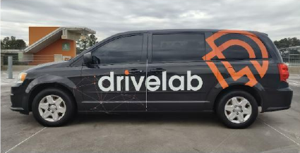
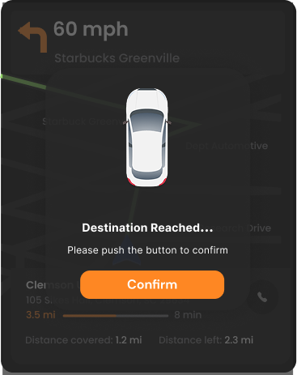

# Accessible Autonomous-Vehicle Interfaces

**Raphael Ugboko · NHTSA project · DRIVE Lab, Clemson University**

I conducted user research, designed mobile and in-vehicle prototypes, and evaluated vehicle interactions with the DRIVE Lab team. The work spanned participant groups with different access needs, including deaf and hard-of-hearing participants, people with low vision, people with motor impairments and participants without disabilities.

**[Read the portfolio case study](https://ralphugboko.dev/projects?discipline=ux-research&project=drive-lab)** · **[Research methods](docs/research-methods.md)** · **[Prototype evidence](docs/design-evidence.md)**

## Research question

How can passengers with different access needs understand and use autonomous-vehicle interfaces?

I connected contextual inquiry and participatory design with prototyping and evaluation. The aim was to understand how passengers request actions, receive information and make sense of an automated journey.

## My work

I conducted contextual inquiry, facilitated participatory design, recruited and moderated participants, built Figma/Bubble prototypes, ran on-road study sessions, coded qualitative material, analyzed quantitative evidence and wrote research reports with the team.

## A concrete design example

DHH participants needed a visual way to recognize arrival. I made the arrival state explicit with a written “Destination Reached” message and a visible Confirm button.

The evaluation focus is whether a passenger can notice arrival, understand the message and complete confirmation without depending on an audio cue. This example documents a user need and design response; the linked case study explains the broader research process.

My research judgment was to translate that reported need into a testable interaction requirement. The prototype shows the design decision; user testing must establish its usability and accessibility. [Read the example](docs/design-evidence.md#my-research-judgment).

The [prototype evidence guide](docs/design-evidence.md) also includes an original low-vision navigation panel. These examples sit within a larger collection of mobile and in-vehicle group/session prototypes.

## Repository contents

- `docs/research-methods.md`: methods, responsibilities and interpretation.
- `docs/design-evidence.md`: selected prototype details and the need-to-design connection.
- `assets/`: the approved research-vehicle photograph and two original Figma detail exports.
- `ATTRIBUTION.md`: artifact and publication references.

This repository contains public case-study materials and selected artifacts. Internal study documents, participant records and unpublished study findings are excluded.

## Publication

Julian Brinkley and Raphael Ugboko. **Accessible Autonomous Vehicles as Symbiotic Autonomous Systems for Users with Disabilities: Preliminary Design Guidelines.** ICHMS 2024.

[Publication](https://doi.org/10.1109/ICHMS59971.2024.10555877) · [Publications page](https://ralphugboko.dev/publications#selected-accessible-autonomy)
