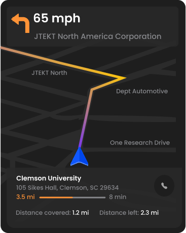

# Prototype evidence

## Visual arrival confirmation

**Reported user need:** deaf and hard-of-hearing participants needed a visual way to know that they had reached their destination.

**My design response:** I displayed “Destination Reached,” a written instruction and a prominent Confirm button. The interface makes the journey-state change and next action visible.

**Evaluation focus:** can a passenger notice arrival, understand the message and complete confirmation without an audio cue?

**Design lesson:** accessibility needs to shape both the notification of a journey event and the action a passenger takes in response.

## My research judgment

I translated the reported need into a testable interaction requirement: a passenger should be able to recognize arrival visually and identify the confirmation action. I paired an explicit arrival message with a visible next step in the prototype.

The screen documents that design response. User testing is needed to establish whether passengers reliably notice, understand and use it; the artifact alone does not establish prototype accessibility.

## Low-vision navigation detail

This original panel comes from the low-vision in-vehicle prototype. It shows a route map, direction, destination and journey information. It provides another example from the collection; it is not presented as a measured comparison with the DHH design.

## Artifact scope

These are selected detail exports from the original Figma designs. The public repository does not include full Figma project files, participant records or internal research documents.

[Research methods](research-methods.md) · [Portfolio case study](https://ralphugboko.dev/projects?discipline=ux-research&project=drive-lab)
